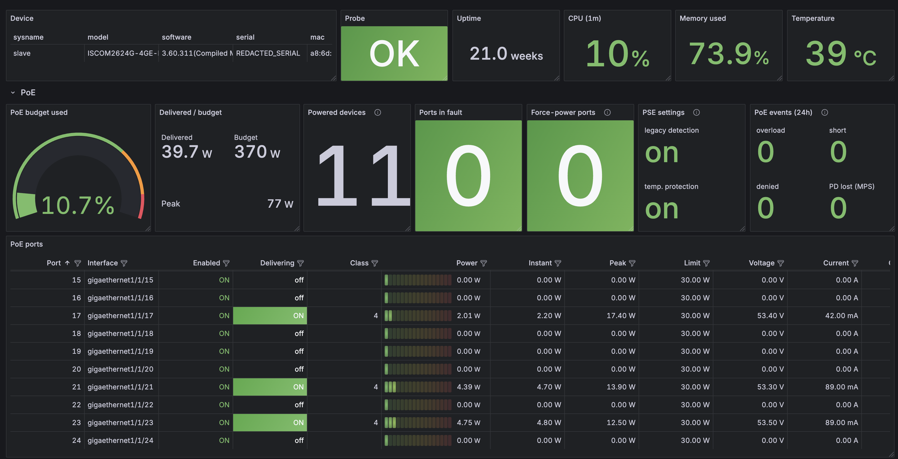

# raisecom-snmp-exporter

**English** | [Русский](README.Ru.md)

Prometheus exporter for Raisecom switches running ROS 5.x (ISCOM2600G series), focused on detailed PoE metrics.
It collects data over SNMP (v2c/v3) and works in multi-target mode like `snmp_exporter`: one exporter polls any
number of switches, and Prometheus passes the address in `/probe?target=`.

Tested on **ISCOM2624G-4GE-PWR-AC**, ROS 3.60.311 (ROS_5.2.1_20200325).



## What it collects

| Collector    | Source                                              | Provides                                                              |
|--------------|-----------------------------------------------------|-----------------------------------------------------------------------|
| `poe`        | POWER-ETHERNET-MIB + private branch `8886.6.1.51`   | per port: status, class, priority, watts (average/instant/peak/limit), volts, amps, overload/short/denied/MPS counters, settings; per PSE: budget, consumption, peak, usage % |
| `interfaces` | IF-MIB / ifXTable                                   | status, speed, 64-bit byte/packet counters, errors, discards          |
| `system`     | RAISECOM-SYSTEM-MIB, FANMONITOR, iscomSwitch        | model/serial/firmware, uptime, CPU, memory, temperature, fans         |
| `sfp`        | RAISECOM-OPTICAL-TRANSCEIVER-MIB                    | module info and DDM: temperature, Tx/Rx dBm, bias, voltage, thresholds and alarm status |

### Why SNMP and not the CLI

Everything needed, including watts/volts/amps for every PoE port, is available over SNMP (Raisecom's private
branch). SNMP is faster (about 3 s for a full poll versus tens of seconds of logging in and paging through
`--More--`), does not occupy VTY sessions, does not flood the log with logins and does not break when the CLI
output format changes.

## Switch preparation

Enable SFP digital diagnostics (DDM) on the switch; without it the transceiver tables are empty and only
`raisecom_sfp_ddm_enabled 0` is exported:

```
config
transceiver ddm enable
exit
write
```

`exit` leaves configuration mode and `write` saves the configuration, so DDM stays enabled after a reboot.

Check it over SNMP: `raisecomOpticalTransceiverDDMEnable` (`1.3.6.1.4.1.8886.1.18.1.2.0`) must be `1`.

```bash
snmpget -v2c -c public <switch> 1.3.6.1.4.1.8886.1.18.1.2.0
```

Everything else the exporter reads (PoE, interfaces, system) works with the factory configuration.

## Quick start

```bash
make build
./bin/raisecom_exporter --config.file=config.example.yml
curl 'http://localhost:9840/probe?target=192.0.2.10&auth=public_v2'
```

### Docker Compose: exporter + Prometheus + Grafana

`deploy/` holds a complete working stack: the published image, Prometheus and Grafana with the dashboard
already provisioned (it opens as Grafana's home page).

```bash
cd deploy
cp .env.example .env                                                        # optional
cp prometheus/targets/raisecom.yml.example prometheus/targets/raisecom.yml  # list your switches here
docker compose up -d
```

Grafana http://localhost:3000, Prometheus http://localhost:9090, exporter http://localhost:9840.
Prometheus picks up changes to `prometheus/targets/raisecom.yml` automatically. The exporter configuration is
`deploy/raisecom/config.yml`.

Every variable is optional; the defaults are in `docker-compose.yml`:

| Variable | Default | Purpose |
|---|---|---|
| `RAISECOM_EXPORTER_TAG` | `latest` | image tag of `andrewpinkerton/raisecom-snmp-exporter`, e.g. `1.0.0` |
| `EXPORTER_LOG_LEVEL` | `info` | exporter log level |
| `SNMP_COMMUNITY` | `public` | SNMPv2c community used in `raisecom/config.yml` |
| `SNMP_AUTH_PASSWORD`, `SNMP_PRIV_PASSWORD` | empty | SNMPv3 passwords (the v3 auth is commented out in `raisecom/config.yml`) |
| `GRAFANA_ADMIN_USER`, `GRAFANA_ADMIN_PASSWORD` | `admin` / `admin` | Grafana administrator; change the password before exposing Grafana |
| `EXPORTER_PORT`, `PROMETHEUS_PORT`, `GRAFANA_PORT` | `9840`, `9090`, `3000` | published ports |
| `PROMETHEUS_RETENTION` | `30d` | how long Prometheus keeps data |
| `TZ` | `UTC` | Grafana time zone |

To build the exporter from source instead of pulling it:
`docker compose -f docker-compose.yml -f docker-compose.build.yml up -d --build`.

## Configuration

```yaml
auths:
  public_v2:
    version: 2
    community: public
  secure_v3:
    version: 3
    username: monitor
    security_level: authPriv        # noAuthNoPriv | authNoPriv | authPriv
    auth_protocol: SHA              # MD5 | SHA | SHA224 | SHA256 | SHA384 | SHA512
    auth_password: ${SNMP_AUTH_PASSWORD}
    priv_protocol: AES              # DES | AES | AES192 | AES256 | AES192C | AES256C
    priv_password: ${SNMP_PRIV_PASSWORD}

modules:
  default:                          # all collectors
    timeout: 5s                     # per SNMP request
    retries: 1
    max_repetitions: 25
  poe_fast:
    collectors: [poe]
    poe_class: false                # skip the PoE class (about 80 ms per powered port)
```

- `auth` may be omitted from the request when the config has a single auth; `module` defaults to `default`.
- Secrets are taken from the environment only in the `${VAR}` form (a lone `$` in a password is left alone).
  If the variable is not set, the config does not load.
- Reload the config with `SIGHUP` or `POST /-/reload`. Validate it without starting: `--config.check`.

### Flags

| Flag                        | Default      | Description                                                             |
|-----------------------------|--------------|-------------------------------------------------------------------------|
| `--config.file`             | `config.yml` | configuration file                                                      |
| `--web.listen-address`      | `:9840`      | HTTP address                                                            |
| `--web.config.file`         |              | TLS/basic auth ([exporter-toolkit](https://github.com/prometheus/exporter-toolkit/blob/master/docs/web-configuration.md)) |
| `--scrape.timeout-offset`   | `500ms`      | subtracted from `X-Prometheus-Scrape-Timeout-Seconds`                   |
| `--log.level`, `--log.format` | `info`, `logfmt` |                                                                   |

### Prometheus

```yaml
scrape_configs:
  - job_name: raisecom
    scrape_interval: 30s
    scrape_timeout: 15s
    metrics_path: /probe
    params:
      module: [default]
      auth: [public_v2]
    static_configs:
      - targets: [192.0.2.10]
    relabel_configs:
      - source_labels: [__address__]
        target_label: __param_target
      - source_labels: [__param_target]
        target_label: instance
      - target_label: __address__
        replacement: raisecom-snmp-exporter:9840
```

A complete example with file_sd: `deploy/prometheus/prometheus.yml`.

## Metrics

Every per-port metric carries the labels `ifindex`, `port` (number, `10`), `ifname` (`gigaethernet1/1/10`) and
`description` (the port description set in ROS).

### PoE

| Metric | Type | Description |
|---|---|---|
| `raisecom_poe_port_admin_enabled` | gauge | PoE is enabled on the port |
| `raisecom_poe_port_delivering` | gauge | the port is delivering power (0/1) |
| `raisecom_poe_port_detection_status{status}` | gauge | state set: disabled, searching, delivering, fault, test, other_fault |
| `raisecom_poe_port_class` | gauge | PD class 0–4 (only on ports with a connected PD) |
| `raisecom_poe_port_priority{priority}` | gauge | state set: critical, high, low |
| `raisecom_poe_port_power_watts` | gauge | power drawn (smoothed) |
| `raisecom_poe_port_power_instant_watts` | gauge | instantaneous power sample |
| `raisecom_poe_port_power_peak_watts` | gauge | peak power on the port |
| `raisecom_poe_port_power_limit_watts` | gauge | port power limit |
| `raisecom_poe_port_voltage_volts` | gauge | voltage |
| `raisecom_poe_port_current_amperes` | gauge | current |
| `raisecom_poe_port_overload_total` | counter | overload protection trips |
| `raisecom_poe_port_short_total` | counter | short circuits |
| `raisecom_poe_port_power_denied_total` | counter | power denied (budget exhausted) |
| `raisecom_poe_port_mps_absent_total` | counter | power removed because MPS was lost (PD disconnected) |
| `raisecom_poe_port_invalid_signature_total` | counter | invalid PD signature |
| `raisecom_poe_port_force_power` | gauge | force-power is on: power is applied without PD detection (dangerous for non-PoE devices) |
| `raisecom_poe_port_alive_check` | gauge | the PD alive check is enabled (`poe alive check`) |
| `raisecom_poe_port_alive_action{action}` | gauge | state set, what to do when a PD fails: none, reboot, reboot_alarm, alarm |
| `raisecom_poe_power_budget_watts` | gauge | PSE budget |
| `raisecom_poe_power_consumption_watts` | gauge | total consumption, averaged by the switch (mW precision) |
| `raisecom_poe_power_peak_watts` | gauge | peak total consumption |
| `raisecom_poe_power_usage_ratio` | gauge | consumption / budget |
| `raisecom_poe_usage_threshold_ratio` | gauge | PSE usage alarm threshold |
| `raisecom_poe_pse_oper_status{status}` | gauge | state set: on, off, faulty |
| `raisecom_poe_pse_legacy_detection` | gauge | legacy PD detection is enabled (`poe legacy`) |
| `raisecom_poe_pse_temperature_protection` | gauge | PSE over-temperature protection is enabled (`poe temperature-protection`) |

### Interfaces

`raisecom_interface_oper_up`, `raisecom_interface_admin_up`, `raisecom_interface_speed_bytes`,
`raisecom_interface_last_change_timestamp_seconds`,
`raisecom_interface_{receive,transmit}_{bytes,unicast_packets,multicast_packets,broadcast_packets,errors,discards}_total`.

### System

`raisecom_device_info{model,serial,hardware,software,bootrom,mac,sysname}`, `raisecom_uptime_seconds`,
`raisecom_cpu_utilization_ratio{period="1s|5s|1m|10m|2h"}`, `raisecom_memory_{total,available}_bytes`,
`raisecom_temperature_celsius`, `raisecom_temperature_{min,max}_celsius`,
`raisecom_temperature_threshold_celsius{type="low|high"}`, `raisecom_fan_speed_rpm{fan}`, `raisecom_fan_up{fan}`,
`raisecom_fan_speed_level{fan}`.

### SFP / DDM

| Metric | Description |
|---|---|
| `raisecom_sfp_ddm_enabled` | DDM is enabled globally on the switch |
| `raisecom_sfp_info{type,media,vendor,part_number,serial,wavelength_nm,distance_meters,ddm_supported}` | installed module |
| `raisecom_sfp_temperature_celsius`, `raisecom_sfp_voltage_volts`, `raisecom_sfp_bias_current_amperes`, `raisecom_sfp_tx_power_dbm`, `raisecom_sfp_rx_power_dbm` | DDM values (only for modules with DDM) |
| `raisecom_sfp_threshold{param,level}` | module thresholds: `level` = high_alarm, high_warning, low_warning, low_alarm; `param` is the name of a metric above |
| `raisecom_sfp_alarm_status{param}` | 0 unknown, 1 normal, 2 high alarm, 3 high warning, 4 low alarm, 5 low warning |

DDM is enabled globally on the switch (see [Switch preparation](#switch-preparation)). While it is off, ROS
returns empty transceiver tables, so only `raisecom_sfp_ddm_enabled 0` is exported.

### Exporter

`raisecom_probe_success`, `raisecom_probe_duration_seconds`, `raisecom_collector_success{collector}`,
`raisecom_collector_duration_seconds{collector}`. On the exporter's own `/metrics`:
`raisecom_exporter_probes_total{module,result}`, `raisecom_exporter_config_last_reload_successful`, `raisecom_exporter_build_info`.

## OID map and ROS quirks

| Data | OID | Notes |
|---|---|---|
| PoE port (standard) | `1.3.6.1.2.1.105.1.1.1.<col>.1.<ifIndex>` | PSE group = 1, port = ifIndex |
| PoE PSE (standard) | `1.3.6.1.2.1.105.1.3.1.1.<col>.1` | consumption in whole watts |
| PoE port (Raisecom) | `1.3.6.1.4.1.8886.6.1.51.1.1.<col>.1.<ifIndex>` | 1 peak mW, 2 power mW, 3 instant mW, 4 mV, 5 mA, 6 limit mW, 8 force-power, 10 alive check, 11 alive action |
| PoE PSE (Raisecom) | `1.3.6.1.4.1.8886.6.1.51.2.1.<col>.1` | 1 average consumption mW, 2 peak mW, 3 legacy detection, 5 temperature protection, 8 budget W |
| Port description | `1.3.6.1.4.1.8886.6.1.20.1.1.1.2.<ifIndex>` | `ifAlias` is empty on ROS |
| Device info | `1.3.6.1.4.1.8886.6.1.1.1.{1,2,9,13,14,19}.0` | software, hardware, MAC, bootrom, serial, model |
| CPU | `1.3.6.1.4.1.8886.1.1.1.5.1.4.1.2.<period>` | %, periods 1s/5s/1m/10m/2h |
| Memory | `1.3.6.1.4.1.8886.1.1.3.{1,2}.0` | total / available, bytes |
| Temperature | `1.3.6.1.4.1.8886.1.1.4.2.{1,2,3,5,6}.0` | °C |
| Fans | `1.3.6.1.4.1.8886.1.1.5.2.2.1.{2,3,4}.<fan>` | rpm, state, level |
| SFP info | `1.3.6.1.4.1.8886.1.18.2.1.1.1.<col>.<ifIndex>` | |
| SFP DDM | `1.3.6.1.4.1.8886.1.18.2.2.1.1.<col>.<ifIndex>.<param>` | param: 1 temperature (m°C), 2 bias (µA), 3 Tx, 4 Rx (dBm×1000), 5 voltage (mV) |

ROS agent quirks handled in the code:

- **OIDs come back out of order** (for example in the process table `8886.1.1.1.5.2`). Walks run without the
  increasing-OID check and are protected against loops by a row limit and repeat detection instead.
- **RAISECOM-SYSTEM-MIB scalars are shifted** relative to the MIB file (memory at `raisecomMemory.N.0`, CPU at
  `raisecomCpu.5`); the actual device OIDs are used.
- **SFP wavelength** is reported in nm, although the MIB says pm.
- **`pethPsePortPowerClassifications` is slow to answer**: the agent queries the PoE controller, about 80 ms per
  port, and a full walk takes about 2 s. The class is therefore read with a single GET for `delivering` ports only.
- **Polling speed is limited by the agent itself**: about 0.1 s per request regardless of response size. A full
  probe takes about 3.5 s (system 0.5, interfaces 1.0, poe 1.6, sfp 0.3); the `poe_fast` module about 1 s.
  Use a `scrape_timeout` of at least 10 s.
- **Unreachable switch:** after the first timeout the remaining collectors are skipped, so the probe stays within
  the scrape timeout.

The meaning of the columns of Raisecom's private PoE table was derived from data, since there is no public MIB.
Measurements were checked against `show poe interface` / `show poe pse` and the standard MIB; settings were
identified by toggling them via the CLI (details in [mibs/README.md](mibs/README.md)).

## Security

- Use a dedicated read-only community restricted by an ACL to the exporter's address, or better SNMPv3 `authPriv`.
- Make sure no community with write access (such as `private`) is enabled on the switch, and disable it if so:
  the exporter only needs read access.
- The exporter's web endpoint can be protected with TLS and basic auth via `--web.config.file`.

## Deployment

- **Docker:** image [`andrewpinkerton/raisecom-snmp-exporter`](https://hub.docker.com/r/andrewpinkerton/raisecom-snmp-exporter):
  distroless, about 15 MB, runs as non-root, built for linux/amd64 and linux/arm64. Mount the config at
  `/etc/raisecom_exporter/config.yml`:

  ```bash
  docker run -d -p 9840:9840 -v $PWD/config.yml:/etc/raisecom_exporter/config.yml:ro \
    andrewpinkerton/raisecom-snmp-exporter:1.0.0
  ```

  Versions follow SemVer (the number is in the `VERSION` file). Each release is published as a single tag with
  the exact version, such as `1.0.0`.
  - `make docker` builds a local image;
  - `make docker-push` pushes it (host platform only);
  - `make docker-release` builds amd64+arm64 and pushes right away.

  Pushing requires `docker login`.
- **systemd:** `deploy/systemd/raisecom-snmp-exporter.service` (DynamicUser, hardening). Installation steps are in a
  comment inside the file. Put secrets in `/etc/default/raisecom_exporter` with mode 0600.
- **Grafana:** dashboard `grafana/raisecom.json` (datasource and switch variables). It is generated by
  `python3 grafana/gen_dashboard.py > grafana/raisecom.json`.

## Development

```bash
make test     # unit + golden tests on a real dump, testdata/iscom2624g.walk
make lint     # gofmt + go vet
make golden   # regenerate internal/collector/testdata/*.prom after an intentional output change
```

Fixtures are recorded like this (only the needed branches):

```bash
snmpbulkwalk -v2c -c public -On -Oe -Ot -Cc <switch> 1.3.6.1.4.1.8886.6.1.51 >> testdata/<model>.walk
```

## MIBs

`mibs/` contains MIBs for every private object the exporter reads, in two variants:
- `RAISECOM-ISCOM2600G-MIB.mib`: one self-contained file that imports only SNMPv2-SMI/TC/CONF;
- `mibs/modules/`: the same objects split into modules, the way vendors usually ship them.

Both variants are generated by `mibs/gen_mibs.py` and checked by `make mibcheck`. Details and differences from
the vendor MIBs are in [mibs/README.md](mibs/README.md). The exporter itself does not load MIBs; the
OIDs are built into the code.

## License

[MIT](LICENSE)
